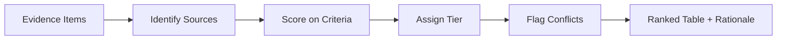

<!-- VITRUVIUS-COMPILED-SKILL:BEGIN v1 sha256=7ddbcd75b316333440ce51df25341d1fbd32ccfe9aa83e6d1597de8ea5bad490 -->

# Evidence Ranking

Score and rank engineering evidence using the tier system from `references/evidence-quality-tiers.md`. This skill provides transparent, auditable evidence scoring — never a black-box "relevance" score.

Alongside the tier, two appraisal dimensions score how much a finding deserves belief: GRADE certainty and risk of bias. See `references/evidence-appraisal-frameworks.md`. The tier ranks the source; those two rank the belief. They are recorded side by side and never summed into one number.

## Input Gate

Before searching, name the question, the artifact/scope (or say it is a
literature review), the jurisdiction/edition, and the effort budget (user-set or
thorough). Ask ONE clarifying question if the ask is too vague, then proceed.
See `references/input-gate.md`.

## Workflow



## Invocation

```
/evidence-ranking <research question>
```

Optionally provide a list of sources to rank. If none provided, use `scholarly-research` to discover sources first, then rank them.

## Methodology

### Increment Checklist (complete before Output)

- [ ] At least 5 evidence items identified
- [ ] Each item scored on all 5 criteria (source tier, methodology, citation authority, reproducibility, recency)
- [ ] Tier assigned to each item (1-4)
- [ ] Each item carries a certainty and a bias judgement, or `n/a` with the reason stated
- [ ] No tier score is added to an appraisal score — they answer different questions
- [ ] Conflicts between sources identified
- [ ] Evidence strength stated with justification

If any checkbox is unchecked, complete the missing work before writing output.

1. **Identify evidence items** — from user input or scholarly-research discovery. Each item needs: title, authors, year, venue, DOI/URL, and a brief summary of the claim it supports.

2. **Score each source** using the criteria in `references/evidence-ranking-methodology.md`.

3. **Assign tier** — see `references/evidence-ranking-methodology.md`. The tier ranks the source, not the finding.

4. **Score the appraisal dimensions** — GRADE certainty and risk of bias, per `references/evidence-appraisal-frameworks.md`. They rank how much the finding deserves belief, so they sit **beside** the tier and are never summed into it: a Tier 1 source can publish a low-certainty finding, and rating the same defect once in design and once in bias double-counts it. Where a framework does not apply — most engineering evidence has no randomization and is not a body of evidence — record `n/a` with the reason rather than a forced score.

5. **Flag conflicts** — when sources disagree, identify the conflict, note which is newer, which is jurisdiction-specific, and what a decision-maker should weigh.

## Output

### Inline Summary (chat response)
- Research question
- Top 3 sources by tier and score
- Conflicts identified (if Any)
- Overall evidence strength for the question

### Full Ranking (saved to disk)

Save to `outputs/evidence-ranking/<slug>.md`:

```markdown
# Evidence Ranking: <research question>

## Question
<restated question>

## Evidence Items

| # | Source | Year | Venue | Tier | Score | Certainty | Bias | Applicability | Key Claim | Status |
|---|--------|------|-------|------|-------|-----------|------|---------------|-----------|--------|
| 1 | [Author](DOI) | 2024 | Journal | 1 | 9 | high | RoB 2 v2 | direct | <claim> | verified |
| 2 | [Author](DOI) | 2023 | Conference | 3 | 5 | low | n/a — no comparator, see rationale | indirect (material) | <claim> | verified |

## Tier Distribution
- **Tier 1:** <count> sources
- **Tier 2:** <count> sources
- **Tier 3:** <count> sources
- **Tier 4:** <count> sources (rejected as primary)

## Scoring Rationale

### Source 1: [title]
- **Tier:** 1 | **Score:** 9/10
- **Why:** Standard/code provision, cited by [standard], experimental validation
- **Limitations:** <scope, age, jurisdiction>

## Conflicts

### Conflict: <description>
- **Source A** says: <claim> [Tier 1]
- **Source B** says: <claim> [Tier 2]
- **Resolution:** A is newer and cited by standards; B is jurisdiction-limited

## Evidence Strength
- **Overall:** Strong / Moderate / Weak
- **Recommendation:** <what the evidence supports, with qualifications>
```

### Quality Gate (mandatory before returning)

Self-check the output. If any check fails, retry once with feedback:

1. **Source count** — at least 5 sources ranked. If < 5, expand search.
2. **Tier distribution** — at least 2 tiers represented. If all Tier 4, re-search with better terms.
3. **Scoring rationale** — each source has explicit scoring rationale. If missing, add reasoning.
4. **Conflict identification** — conflicts between sources are flagged. If none found but sources disagree, re-analyze.
5. **Appraisal present** — every row carries a certainty and a bias judgement, or `n/a` with a stated reason. A blank cell is a gap, not a pass.
6. **No summing** — nothing in the output adds a tier score to a certainty or bias judgement. Tier is authority; certainty is belief.
7. **Evidence strength** — overall strength is stated with justification. If missing, add reasoning.

**Retry logic:** If quality gate fails, re-run the ranking once with the specific failure as feedback. If it fails again, return the best output with a `Weak` evidence strength and list the unresolved issues.

Write `outputs/evidence-ranking/<slug>.provenance.md` beside the ranking (sources consulted, accepted, and rejected; verification status). Minimal shape: `references/provenance-sidecar.md`.

## Scope and Boundaries

- This skill scores evidence — it does NOT select the "best" source. Human engineering judgment decides.
- **Research-only, not for final engineering sign-off.**
- Never fabricate scores. If a source cannot be assessed, mark it `unverified`.
- Tier 4 sources are flagged as rejected for primary use but may support context.
- Evidence quality: see `references/evidence-quality-tiers.md`.
